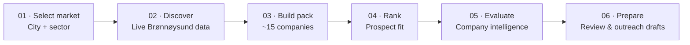

# Relista

**Less searching. Better prospecting.**

Relista turns official Norwegian company-registry data into curated B2B prospecting packs. Choose a city and sector, review fit signals, and prepare outreach drafts you send yourself.

Relista does not send email and does not invent contacts.

## How it works

## Core capabilities

| Capability | Purpose |
|---|---|
| Weekly prospect packs | Curated list of companies for a saved market |
| Fit ranking | Ranks by email quality, staff band, and company age |
| Company intelligence | ICP match High / Medium / Low with reasons |
| P0 trust labels | Separates Brreg facts from AI interpretation |
| Outreach drafts | Editable first emails · copy only |
| Manual outcomes | Status and results stay under human control |

## Product principles

- **Evidence first** — Brønnøysundregistrene is the source of truth  
- **No fabricated intelligence** — abstain when evidence is missing  
- **Human control** — AI assists; you decide and send  

## Technology

| Layer | Stack |
|---|---|
| Frontend | React, Vite, Tailwind CSS |
| Backend | Python, FastAPI |
| Company data | Brønnøysundregistrene · Enhetsregisteret |
| AI | Azure OpenAI |

---

Private MVP. Runs locally. Active development.
