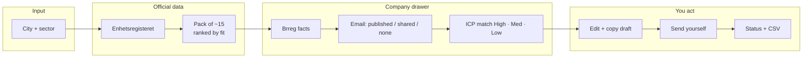

# Relista

Weekly work pack for Norwegian B2B teams.

Search a city and sector, get registered AS companies from Enhetsregisteret, see why each row is in the pack, and edit a first email. Relista does not send email and does not invent contacts.

Private MVP. Runs locally: FastAPI plus React.

**Trust rules:** Brreg only · no invented contacts · AI is interpretation not fact · Relista never sends email.
